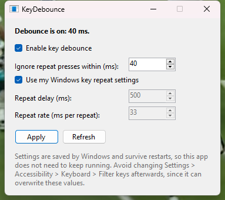

# KeyDebounce

A tiny Windows app that fixes keyboard chatter (one key press registering twice) by setting the Windows **Filter Keys bounce time** to a value you choose, like 40 ms.

Windows already has this feature ("bounce keys"), but the Settings app only offers 0.3 seconds or more. That's long enough to swallow double letters you type on purpose. The underlying Windows API accepts any value, and KeyDebounce exposes it.



## Usage

1. Download `KeyDebounce.exe` from [Releases](../../releases) and run it. No install needed.
2. Tick **Enable key debounce**, set the time (40 ms is a good start), and click **Apply**.
3. Close the app. Windows saves the setting, so it stays on after restarts.

Tuning:

- Still getting doubles? Raise it to 60 or 80 ms.
- Fast double letters (the "ll" in "really") going missing? Lower it to 25 or 30 ms.
- To turn it off, untick **Enable key debounce** and click **Apply**.

## How it works

It calls `SystemParametersInfo(SPI_SETFILTERKEYS)` with `iBounceMSec` set to your value. While Filter Keys is on, Windows also handles key auto-repeat itself, so KeyDebounce copies your normal repeat delay and rate from Control Panel > Keyboard. Without that, holding a key would type it only once. You can enter custom repeat values instead if you prefer.

The Filter Keys beep, taskbar icon and keyboard shortcut are left off.

Note: after you apply a value, avoid changing **Settings > Accessibility > Keyboard > Filter keys**. That page can't show times below 0.3 s and may overwrite yours.

## Requirements

Windows 10 or 11. It runs on .NET Framework 4.8, which comes with Windows.

## Building

```
dotnet build -c Release
```

The exe lands in `bin/Release/net48/`.

## License

MIT
